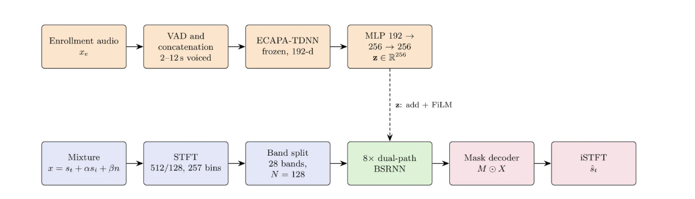
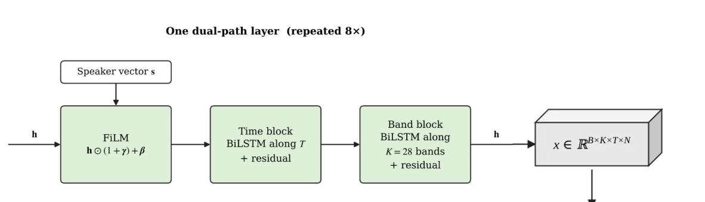

# TSE-BSRNN: Target Speaker Extraction with a Speaker-Conditioned Band-Split RNN

Extracts one target speaker's voice from a mixture (interfering speakers and/or background noise), given a short enrollment clip of that speaker. The model is a Band-Split RNN (BSRNN) conditioned on an ECAPA-TDNN speaker embedding.

- Input: 16 kHz mono mixture + enrollment audio of the target speaker
- Output: estimated target-speaker waveform

## Architecture

**Speaker branch (top).** The enrollment audio is passed through VAD and concatenated to 2-12 s of voiced speech. A frozen ECAPA-TDNN produces a 192-d embedding, and a small MLP (192 → 256 → 256) maps it to the speaker vector **z** ∈ ℝ²⁵⁶.

**Mixture branch (bottom).** The mixture x = s_t + α·s_i + β·n (target, interfering speaker, noise) goes through an STFT (n_fft 512, hop 128, 257 bins) and is split into 28 subbands, each projected to N = 128 features. Eight dual-path BSRNN layers process these features. The mask decoder predicts a complex mask M, and the masked spectrogram M ⊙ X is converted back to the estimated target waveform ŝ_t with an iSTFT.

**Conditioning.** The speaker vector is injected in two places: added to the band-split features once, and applied through FiLM inside every dual-path layer.

## Inside one dual-path layer

Each layer takes features of shape B × K × T × N (batch, bands, frames, features) and applies three steps:

1. **FiLM:** the speaker vector produces a scale γ and shift β, giving h ⊙ (1 + γ) + β. The FiLM layer is zero-initialized, so training starts from an unconditioned model and learns to use the speaker information.
2. **Time block:** a BiLSTM runs along the time axis T for each band, with a residual connection.
3. **Band block:** a BiLSTM runs along the K = 28 bands for each frame, with a residual connection.

## Dataset

No single dataset contains ready-made target-speaker mixtures, so they are built from two public corpora: clean speech from LibriSpeech and background noise from DEMAND.

### Sources

| Corpus | Used for | Details |
|---|---|---|
| [LibriSpeech](https://www.openslr.org/12) | target speech, interfering speech, enrollment | read English audiobooks, 16 kHz |
| DEMAND (Diverse Environments Multichannel Acoustic Noise Database) | background noise | recordings of real environments (e.g. cafes, streets, homes, transport), used as 16 kHz mono files |

LibriSpeech subsets per role:

| Role | Subsets |
|---|---|
| Train | `train-clean-100`, `train-clean-360` |
| Validation | `dev-clean` |
| Test | `test-clean` |

The LibriSpeech subsets have no speakers in common, so validation and test speakers are never seen in training. Noise files that are not 16 kHz mono are dropped when the noise manifest is built.

### Noise split (no leakage)

DEMAND has few recordings, so they are split **in time** instead of by file. Each recording is cut into regions, and every role only draws noise from its own region:

| Role | Part of each noise recording |
|---|---|
| Train | first 80% |
| Validation | 80% - 90% |
| Test | last 10% |

This keeps the same noise audio from appearing in training and evaluation.

### How mixtures are built

Every mixture is a randomly sampled "scene" with one target speaker. Segments are 4 s for training and 6 s for validation and test.

1. **Pick a scenario**, with these probabilities:

   | Scenario | Probability | Contents |
   |---|---|---|
   | `speech_noise` | 45% | target + interfering speaker + noise |
   | `speech` | 25% | target + interfering speaker |
   | `noise` | 25% | target + noise |
   | `clean` | 5% | target only |

2. **Target:** a random speaker, a random utterance long enough for the segment, and a random segment of it.
3. **Interfering speaker:** a different speaker from the same split. The interferer is scaled to a target-to-interferer ratio (SIR) drawn uniformly from -5 to +5 dB. In 50% of scenes it covers only part of the segment (30% - 100% of its length, at a random position), so the target also speaks alone in places.
4. **Noise:** a random DEMAND file and a random position inside its role's time region. It is scaled to a signal-to-noise ratio (SNR) drawn uniformly from -5 to +15 dB, relative to the target plus interferer.
5. **Level and clipping:** the final mixture is normalized to an RMS level drawn uniformly from -35 to -15 dBFS and peak-limited to 0.99. The same gain is applied to the target, so the reference stays aligned with the mixture.

The training target is the clean target segment after that gain.

### Enrollment audio

Each speaker gets a bank of enrollment clips, built once and cached as ECAPA embeddings:

- **Clips per speaker:** 10 for training, 6 each for validation and test.
- **Content:** utterances of that speaker are concatenated and passed through an energy-based VAD, then cut to exactly 2, 3, 5, 8 or 12 s of voiced speech (probabilities 15%, 20%, 30%, 20%, 15%). The varied lengths teach the model to cope with short and long enrollments.
- **No overlap with the target:** the utterance used as the target in a mixture is never part of the enrollment clip paired with it.
- **Embedding:** the clip is encoded once by the frozen ECAPA-TDNN (192-d), so training only reads the cached vector.

### How the data is used

| | Training | Validation | Test |
|---|---|---|---|
| Mixtures | generated on the fly, new random scene every call (1000 steps × batch 8 per epoch) | 300 fixed mixtures | 1200 fixed mixtures |
| Reproducible | no (fresh data each epoch) | yes, seeded manifest (seed 1234) | yes, seeded manifest (seed 4321) |
| Segment length | 4 s | 6 s | 6 s |

The best checkpoint is chosen by validation SI-SDR improvement (SI-SDRi) on all scenarios except `clean`. The test set is reported broken down by scenario, enrollment length, SIR and SNR.

## Training objective

SI-SDR loss plus 5x a multi-resolution STFT loss (window sizes 512, 1024, 2048).

## Configuration

All settings live in the yaml file (see `config_big.yaml`):

| Section | Controls |
|---|---|
| `audio` | sample rate, training/eval segment length, min utterance length |
| `splits` | LibriSpeech subsets per train / val / test |
| `noise.frac` | time region of each noise recording used per role |
| `mix` | scenario probabilities, SIR/SNR ranges, mixture level, partial overlap |
| `enroll` | enrollments per speaker, voiced duration choices, VAD settings |
| `model` | `n_fft`, `hop`, feature size `N`, RNN `hidden`, `layers`, embedding sizes |
| `train` | epochs, LR schedule, batch size, AMP, loss weights |
| `eval` | number of val/test mixtures and their seeds |

## Notes

- The model is non-causal (bidirectional time RNN), so it is intended for offline processing.
- Metrics are SI-SDR and SI-SDR improvement (SI-SDRi); the `clean` scenario is excluded from improvement averages.

## Credits

- Architecture: Band-Split RNN, Luo and Yu, [arXiv:2209.15174](https://arxiv.org/abs/2209.15174)
- Speaker embeddings: SpeechBrain ECAPA-TDNN (`speechbrain/spkrec-ecapa-voxceleb`)
- Data: LibriSpeech, DEMAND
